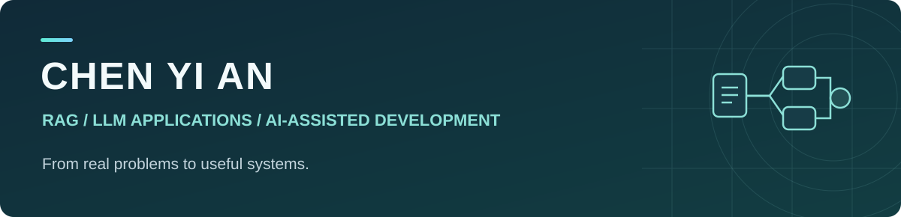

  

## はじめまして、CHEN YI AN です

**現場の課題を、使い続けられる AI システムへ。**

現在、**東京科学大学（Institute of Science Tokyo）で学んでいます。** RAG に関心があり、特に次のテーマを探究したいと考えています。

- **文書の構造・レイアウトを活用したチャンキング：** 見出し・段落・表などの関係を保ち、検索に適した単位に分割する方法。
- **Embedding と検索品質：** 文書の分割方法やベクトル表現が、検索結果の関連性・根拠の取得に与える影響。
- **実務で使える RAG：** 回答の生成に加え、出典の確認、評価、資料更新まで含めたシステム設計。

留学塾での教務経験を出発点に、資料を繰り返し調べる負担を減らす **J-Grad-Admission-RAG** を開発しています。要件整理から設計、実装の検証、改善まで取り組んでいます。

AI コーディングを活用しながら、何を作るか、どの情報を信頼するか、どう確かめるかを重視しています。

[代表プロジェクト](https://github.com/yasu-isct/J-Grad-Admission-RAG) · [設計と技術の説明](https://github.com/yasu-isct/J-Grad-Admission-RAG/blob/main/docs/portfolio/engineering-ja.md) · [開発で学んだこと](https://github.com/yasu-isct/J-Grad-Admission-RAG/blob/main/docs/development-lessons.md)

## 主力プロジェクト · J-Grad-Admission-RAG

### 大学院入試の資料確認を支える、出典付きの情報整理・検索システム

<!-- jgrad-interactive-demo -->
**[▶ ブラウザでデモを試す｜インストール不要](https://yasu-isct.github.io/J-Grad-Admission-RAG/)**

*二校・五つの保存済みサンプルを操作できます。リアルタイムの検索・AI回答は実行しません。*

**現在、最も注力しているプロジェクトです。** 塾内の教務支援を目的としたシステムの公開デモとして、公式 PDF の出願日程・提出書類・試験情報を整理し、個人の状況との照合、参考レポート、自然言語での質問につなげます。

*実装画面：中国語の案内と日本語の公式資料をつなぎ、複数文書の関係を確認できます。[画面集・検証条件を見る →](https://github.com/yasu-isct/J-Grad-Admission-RAG/blob/main/docs/portfolio/screenshots-ja.md)*

- **探す：** キーワード検索とベクトル検索を組み合わせ、関連する公式資料を取得。
- **確認する：** レビュー済みの条件と本人の入力を照合し、日程や準備事項を表示。
- **説明する：** 自然言語の参考回答とは別に、根拠となる文書・ページを保持。
- **更新する：** 学校・資料版の識別と設定生成で、追加・更新時の重複作業を減らす。

現在の公開範囲は、東京科学大学の固定資料と、東京大学・新領域創成科学研究科・複雑理工学専攻の限定テーマです。学校全体の網羅や、合否・出願資格の最終判断を行うものではありません。

**主な技術：** Python / FastAPI / PyMuPDF / pdfplumber / BM25 / BGE-M3 / JavaScript / pytest / Playwright / GitHub Actions

**[リポジトリ →](https://github.com/yasu-isct/J-Grad-Admission-RAG)**　[設計のポイント →](https://github.com/yasu-isct/J-Grad-Admission-RAG/blob/main/docs/portfolio/engineering-ja.md)　[ローカルで試す →](https://github.com/yasu-isct/J-Grad-Admission-RAG/blob/main/docs/portfolio/local-demo-ja.md)

## AI 支援開発で重視していること

- **既存資産から始める。** コード・データ・過去の判断を調べ、再利用できるものを確認してから変更する。
- **実装と検証を分ける。** AI の「完了」だけで判断せず、実データ、実際の操作、回帰テストで確かめる。
- **繰り返す作業は仕組みにする。** AI が整理した内容をレビューし、承認済みの入力から設定を生成する。

[開発上の失敗と改善の記録 →](https://github.com/yasu-isct/J-Grad-Admission-RAG/blob/main/docs/development-lessons.md)

## 関連プロジェクト · J-Grad の前身と拡張構想

### 前身：[file-extract](https://github.com/yasu-isct/file-extract)

PDF の解析・検索・構造化抽出を学ぶための初期プロトタイプです。自然言語 QA への拡張時に、**モデルに渡せる文脈量、処理の待ち時間、繰り返す API 呼び出しのコスト**が課題になりました。検索対象を減らすだけでは必要な文脈も失われるため、J-Grad で構成を見直しました。

J-Grad では、**資料の事前構築と問い合わせを分離**し、構築済みの知識・索引を再利用します。さらに、レビュー済みの条件と自然言語の参考回答を分け、出典・資料版・回帰検証を管理する設計に発展させています。

[当時の実験と、J-Grad への再設計の理由 →](https://github.com/yasu-isct/file-extract#なぜj-gradを別に設計したか)

### 将来の拡張：[Lab-Radar](https://github.com/yasu-isct/Lab-Radar)

研究関心から候補研究室を探す、**J-Grad の研究室検索への拡張構想**です。現在は API・データモデルの初期段階で、検索機能は未実装です。出典に基づく関連性の説明と評価方法を検討しています。

---

関心領域：**RAG / Layout-aware Chunking / Embedding / 検索評価 / AI 支援開発**
